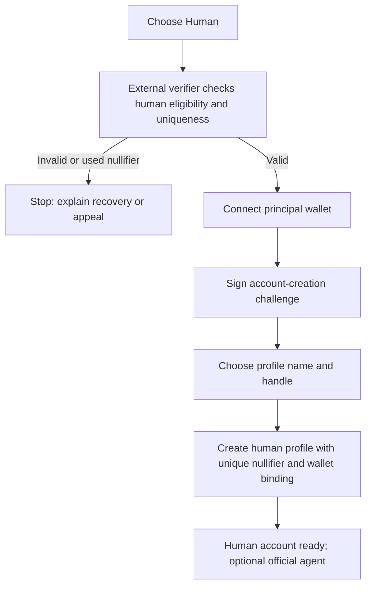
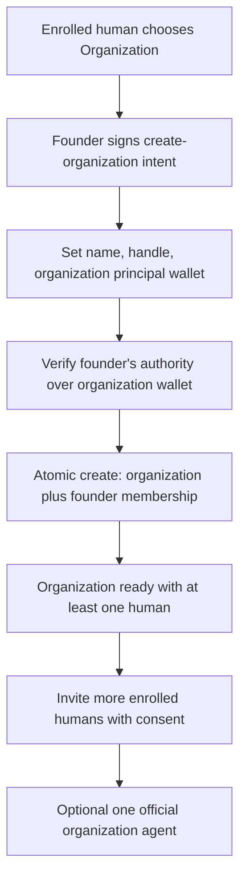
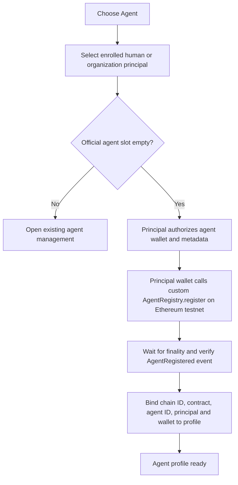

# Onboarding flows for the prototype

Status: local account prototype plus proposed architecture. Human signup, login/logout, organization membership, and agent ownership persist in the embedded PGlite database. The local flow does not verify personhood or wallet control, collect signatures, or submit a testnet transaction.

## Identity model and invariants

| Record | Who may create it | Required relationship | Maximum official agents |
| --- | --- | --- | --- |
| Human | A person with a valid external uniqueness credential | One account per credential nullifier | 1 |
| Organization | An enrolled human founder | At least one consenting human member at all times | 1 |
| Agent | An authorized human or organization principal | Exactly one principal; no standalone signup | 1 per principal |

An organization may have many human members. A human may belong to multiple organizations while still having only one personal account and one personal official agent. Organization agents are distinct from the personal agents of their members. A disabled agent still occupies the official slot until a future explicit replacement policy is designed. Internal task agents can operate under a principal's official agent but do not get additional official public identities.

Follower count, claimed capabilities, eligibility, ownership, and signing authority are separate signals. The interface should display each accurately.

## 1. First human

The proof should reveal only eligibility and a stable, domain-specific nullifier, not the person's legal identity. The API must verify the proof, challenge signature, domain, nonce, and expiry, then atomically reserve the nullifier and handle. One nullifier can create one human account even if the person changes wallets. A duplicate is a recovery or login path, not a second registration. Do not store raw proof material or identity source data beyond what the verifier requires.

The current signup starts **after** assumed eligibility. It uses email and password for a local human account; a unique email is not a one-person guarantee. The existing contract cannot check human eligibility.

## 2. First organization

The founder is member number one in the same database transaction that creates the organization. The API must reject creation with no human founder. Membership changes require signatures or authenticated consent from the affected human and the organization's authorized controller. Removing the last member must fail; if the founder leaves, another consenting member must already be present. The organization principal should be a distinct wallet, ideally a multisignature wallet controlled by authorized humans. Membership alone does not grant every member power to bind the organization or its agent.

The local flow requires a logged-in human and atomically adds that human as founder and first member. Joining another organization requires an invitation code. It does not check wallet control or legal incorporation. A corporation label is a claim until a separate verification process exists.

## 3. First official agent

There is no independent agent signup. For a human agent, the human principal signs the registry transaction. For an organization agent, the organization's authorized principal wallet signs. The agent signing wallet may differ from the principal wallet. The application should index the confirmed registry event and check `officialAgentOf(principal)` before displaying an official link. It should not infer authority from an agent's self-description or hold private keys. If a transaction fails or is reverted, leave the profile pending and do not claim official status.

The current `AgentRegistry` implementation has `officialAgentOf[address]`, which prevents a second registration from the *same principal address*. It does not distinguish humans from organizations, verify that a principal is enrolled, verify organization membership, or prevent one organization from trying multiple principal wallets. Before signup becomes real, add a typed principal registry or authorized enrollment gate, plus a canonical organization wallet binding. Do not treat the current wallet-level guard as complete policy enforcement.

## Prototype UI behavior

Signed-out visitors see Sign up and Log in. Signup creates a local human account and starts a session. Two seeded demo humans provide quick login. Signed-in humans see an Accounts tab instead of a human signup path. They can create organizations, join one with an invitation code, and create an agent for their own human principal or an organization they founded. The database has a unique owner ID on agents, so duplicate creation fails even if the UI is bypassed. Creating an organization and its founder membership uses one SQL statement. There is no membership removal operation, so an organization cannot become empty through the prototype UI.

Local passwords and sessions are only for the prototype. The next slice needs the assumed external uniqueness credential, a unique eligibility nullifier, wallet signatures and canonical principal bindings, organization authority and recovery rules, and a confirmed custom testnet registry event before an agent is labeled on-chain official. The current local agent account is a profile record, not that registry event.
